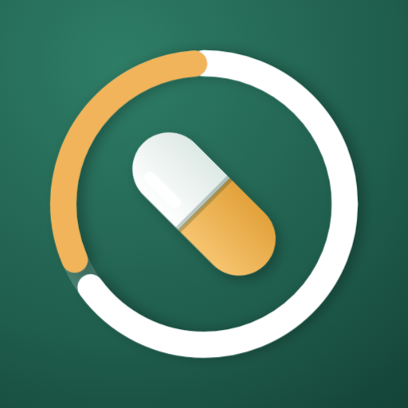

# ICU Antibiotic Time-out

A simple web app for antimicrobial stewardship in the ICU. It tracks every antibiotic course from its start and flags the 48–72 hour time-out review.

**Live app:** https://kiranrajagopal-code.github.io/antibiotic-timeout/

## What it does
- Log each antibiotic: bed number, code name, start time, indication, suspected source, cultures sent before first dose
- Time-out clock: due at 48 h, overdue after 72 h
- Record the decision: continue, de-escalate, IV to oral, escalate or stop, with reasons
- Dashboard: overdue, due now, active courses, and % of time-outs done by 72 h (last 30 days)
- WHO AWaRe category tag for each antibiotic (Access / Watch / Reserve)
- Empirical courses turn purple and flash at 48 h until someone acknowledges them
- Export a PDF report for any date range: summary indicators (time-out ≤ 72 h, cultures before first dose, de-escalation, acknowledgement of 48 h alerts, duration) and a full line listing
- Works on phone and desktop, light and dark mode

## Data and privacy
- Data is saved in the browser of the device being used. It is not sent anywhere and is not shared between devices.
- Identify patients by bed number and a code name only. Never enter real names or IP numbers.

This tool supports, and does not replace, the hospital antibiotic policy.

## Author
Dr. Kiran Rajagopal — Head, Department of Critical Care Medicine, Sree Gokulam Medical College, Trivandrum

## Android app (APK)
Every change pushed to this repository builds a new APK automatically.
Download the latest from **Releases → AntibioticTimeout.apk**:
https://github.com/kiranrajagopal-code/antibiotic-timeout/releases/latest

Install on Android: open the downloaded APK and allow "Install unknown apps" for your browser or Files app when asked. Updates install over the old version and keep the data.

To change the app, edit `index.html` only — the build copies it into the Android app.
