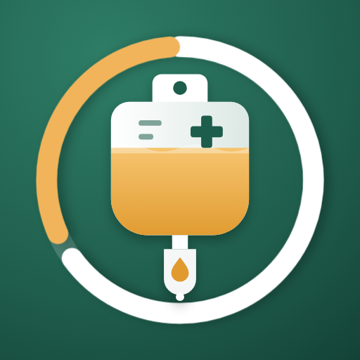

# ICU Antibiotic Time-out

An Android and iPhone app for antimicrobial stewardship in the ICU. It tracks every antibiotic course from its start and flags the 72-hour time-out review (24 hours for prophylaxis).

## What it does
- Log each antibiotic: ICU (CCU, NSICU or other, named), bed number, code name, start time, indication (empirical / targeted / prophylaxis / other, specified), rationale, suspected source, planned duration, cultures sent before first dose
- Time-out deadline: 72 h for empirical, 24 h for prophylaxis; targeted (culture-directed) courses alert at the end of their planned duration
- Record the decision at time-out: continue, de-escalate, IV to oral, escalate, new infection or stop, with reasons and diagnostics — Culture, FilmArray, NGS and FLU NGS recorded independently (any one is enough), each with its site (Blood, BAL, CSF, Fluid, nasopharyngeal swab or other), organisms, sensitive/resistant for culture and resistance genes for FilmArray/NGS
- Change antibiotics in the same window: keep the current antibiotic and add new ones, or stop it and replace — each new antibiotic is linked to the original record. A new empirical antibiotic (e.g. for a new infection during targeted therapy) gets its own 72 h clock, source and culture status
- Empirical courses at 72 h and prophylaxis at 24 h without a time-out turn purple and flash until someone acknowledges them
- Flags courses running past their planned stop date
- Phone notifications for time-outs, reviews and planned stop dates (works with the app closed and after restart)
- Home screen is a compact list, one row per patient (ICU, bed, name, antibiotics, status); tap a row for full details, tap the pencil to edit — history is kept. Changing ICU, bed or name updates all of that patient's antibiotics
- In a patient's row: + Add antibiotic (patient details pre-filled) and Discharge / stop all (discharged, transferred, died, LAMA/DAMA or all stopped)
- Backup to a file (Drive, WhatsApp, email) and restore by merging
- Export a PDF report for any date range and ICU (or all ICUs): 12 indicators, breakdowns (AWaRe, indication, source, organisms, rationale, decisions) and a line listing grouped by patient (one serial number per patient)
- WHO AWaRe category tag for each antibiotic; antifungals and antivirals included, with fungi and viruses in the organism list

## Data and privacy
- Data is saved on the phone only. It is not sent anywhere and is not shared between devices. Use Backup regularly.
- Identify patients by bed number and a code name only. Never enter real names or IP numbers.

This tool supports, and does not replace, the hospital antibiotic policy.

## How to cite
Rajagopal K. *Antibiotic Time-out* [software]. Zenodo; 2026. https://doi.org/10.5281/zenodo.23855568

## Author
Dr. Kiran Rajagopal — Head, Department of Critical Care Medicine, Sree Gokulam Medical College, Trivandrum

## iPhone
Open **https://kiranrajagopal-code.github.io/antibiotic-timeout/** in **Safari** → tap **Share** → **Add to Home Screen** → **Add**.
It then opens full-screen from its own icon and works offline. Data stays on the iPhone; use Backup (Share → Save to Files / Drive).
Notifications are Android-only; on iPhone the alerts show inside the app.

## Android app (APK)
Every change pushed to this repository builds a new APK automatically.
Download the latest from **Releases → AntibioticTimeout.apk**:
https://github.com/kiranrajagopal-code/antibiotic-timeout/releases/latest

Install on Android: open the downloaded APK and allow "Install unknown apps" for your browser or Files app when asked. Updates install over the old version and keep the data.

To change the app, edit `index.html` only — the build copies it into the Android app.
